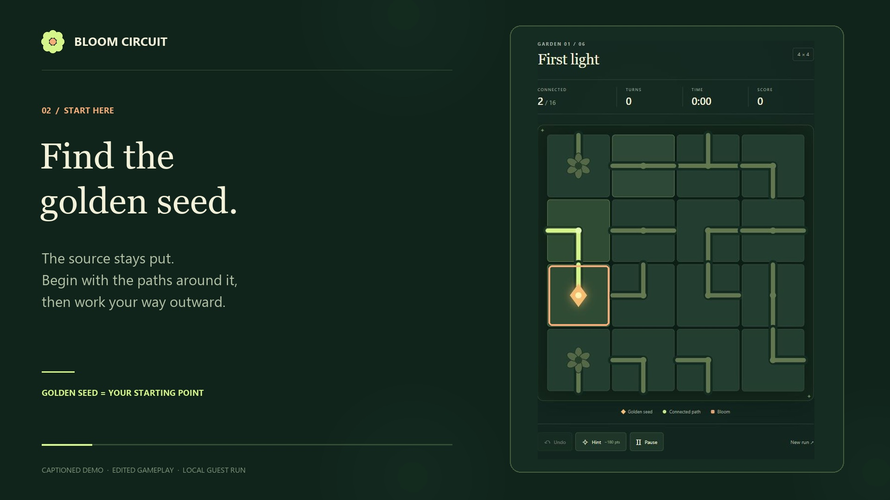

# Gameplay walkthrough

A **65-second, 1080p** captioned demonstration of Bloom Circuit, with click highlights, soft music, and a complete first-garden solve.

## Watch or download

- [MP4 video](bloom-circuit-walkthrough.mp4)
- [Complete offline walkthrough pack](bloom-circuit-walkthrough-pack.zip)
- [English subtitles — SRT](bloom-circuit-walkthrough.srt)
- [English subtitles — WebVTT](bloom-circuit-walkthrough.vtt)

For the player with chapter navigation, download and extract the walkthrough pack, then open `Bloom-Circuit-Walkthrough.html`. The pack includes the video, poster, and subtitles together. Instructional captions are also visible in the video itself.

## Chapters

| Time | Topic |
| --- | --- |
| 0:04 | Connect every tile to the seed |
| 0:08 | Find the golden seed |
| 0:12 | Rotate clockwise |
| 0:15 | Undo a move |
| 0:19 | Rotate counterclockwise |
| 0:23 | Use a hint |
| 0:27 | Connect the paths |
| 0:34 | Pause |
| 0:38 | Finish the lower branches |
| 0:49 | Complete the garden |
| 0:57 | Continue to the next garden |

**Demo result:** 16/16 connected tiles, 17 turns, one hint, **1,416 points**.

The video uses actual browser captures from an isolated local guest run. Playback timing is edited. Audio is original synthesized music and click chimes; there is no voice narration.

## Technical details

1920 × 1080, 24 fps, H.264 video with AAC audio. The full video decoded without errors, and the offline player's chapter seeking was verified in the browser.

[Play on start.ng](https://bloom-circuit.start.ng/) · [Play on infinitesyrup.xyz](https://www.infinitesyrup.xyz/games/bloom-circuit/)
